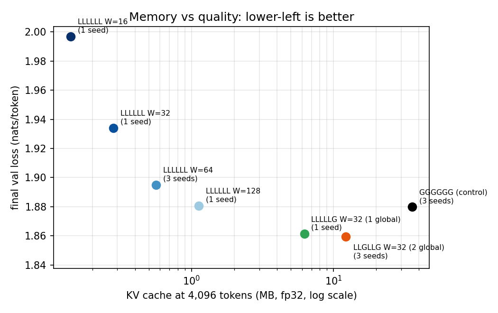
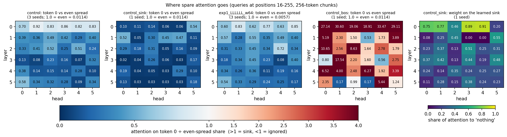
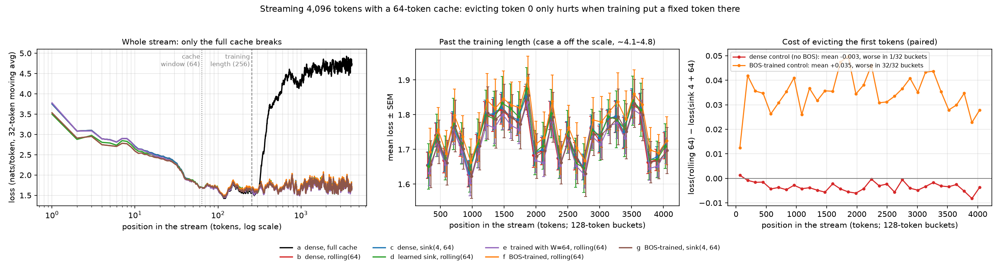

# Tiny Frontier

**How do modern LLMs keep their KV cache cheap?** This repo rebuilds the memory tricks behind Gemma 3, Mistral, StreamingLLM and gpt-oss from scratch in a 3.4M-parameter model, and tests each one with controlled experiments: one change at a time against a fixed control, multiple seeds, every run logged. Everything runs on one Apple M4 laptop, at $0 compute.

Write-up series: [Part 1: Background](https://anush-deokar.vercel.app/writing/tiny-frontier/background) · [Part 2: Local vs global attention](https://anush-deokar.vercel.app/writing/tiny-frontier/local-global-attention) · Full results log: [`docs/results.md`](docs/results.md)

## Headline results

- **The implementation matches Google's Gemma 3 270M to 1.8e-4.** I loaded the real weights into my own code and compared against Hugging Face `transformers`: top-1 token agreement was 100%, and greedy decoding was identical on every prompt, including an 800-token prompt that exercises the 512-token sliding window.
- **Hybrid local/global attention beats full attention and needs much less cache.** `LLGLLG` (four 32-token sliding-window layers, two global) beat the all-global control by 0.020 nats across 3 seeds, with 3× less KV cache at 4,096 tokens. Gemma's 5:1 pattern (`LLLLLG`) matched it at **5.8× less** cache (1 seed).
- **Attention sinks come from the training data format.** A model trained on chunks that start mid-text formed no sink: evicting its first tokens while streaming cost nothing. Adding a fixed `<s>` token at the start of every training chunk created one immediately (up to 33× an even share of attention). Evicting that token then cost +0.035 nats in 32 of 32 buckets, and keeping it, as StreamingLLM does, removed the cost.

<p align="center">
  
  
</p>

## What's in here

**A Llama-style decoder written from scratch** ([`src/tiny_frontier/model/`](src/tiny_frontier/model)): RMSNorm, RoPE, SwiGLU, tied embeddings, GQA/MQA and a KV cache.

**Gemma 3 support as config flags**, not a separate model: `(1 + w)` norms, embedding scaling, QK-norm, sandwich norms, GeGLU, `head_dim ≠ d_model / n_heads`, separate RoPE bases for local and global layers, and local/global layer patterns. The checkpoint converter is in [`convert/gemma3.py`](src/tiny_frontier/convert/gemma3.py).

**Attention variants:**

- sliding-window attention with a layer-pattern string (`L` = local, `G` = global, e.g. `LLLLLG`)
- a rolling KV cache
- a StreamingLLM-style cache that keeps the first *k* tokens plus the last *W*
- a gpt-oss-style learned sink: one logit per head, an "attend to nothing" option

**Training and evaluation:**

- AdamW with warmup and cosine decay, gradient clipping, and seeded data order
- loss by position, so you can see where a window hurts
- streaming evaluation over 4,096-token sequences under any cache policy
- attention-on-token-0 analysis, and a generation speed and memory benchmark

**Reproducibility:**

- Every run writes a folder with its config, git commit, data hash, loss log, summary and sample.
- Configs reject unknown keys and wrong types.
- The test suite runs on CPU and Apple's GPU (MPS), and includes a regression test that pins the trained control to its recorded loss.

## Results at a glance

**Control:** 6 layers, d_model 192, 6 heads, 256-token context, 3.4M parameters, 50M tokens of TinyStories. Validation loss is **1.8798** (3 seeds, spread 0.0087). That spread is the noise floor: a gap under ~0.01 counts as no effect.

**Experiment 1: local vs global attention** ([details](docs/results.md#experiment-1-localglobal-attention))

| Variant | Seeds | Val loss | vs control | KV @ 4,096 tokens |
| --- | --- | --- | --- | --- |
| `GGGGGG` (control) | 3 | 1.8798 | — | 36.0 MB |
| `LLLLLL` W=128 | 1 | 1.8806 | +0.001 | 1.13 MB |
| `LLLLLL` W=64 | 3 | 1.8951 | +0.015 | 0.56 MB |
| `LLLLLL` W=32 | 1 | 1.9340 | +0.054 | 0.28 MB |
| `LLLLLL` W=16 | 1 | 1.9969 | +0.117 | 0.14 MB |
| `LLGLLG` W=32 | 3 | **1.8596** | **−0.020** | 12.2 MB |
| `LLLLLG` W=32 | 1 | **1.8613** | **−0.019** | **6.2 MB** |

**Experiment 2: attention sinks and streaming** ([details](docs/results.md#experiment-2-attention-sinks-and-streaming)). These are 4,096-token streams, 16× the training length, with only the KV cache policy changed:

| Case | Mean loss, positions 256–4,095 |
| --- | --- |
| control, full cache | **4.503** (breaks past the training length) |
| control, rolling(64) | 1.738 |
| control, sink(4) + rolling(64) | 1.742 |
| learned-sink model, rolling(64) | 1.744 |
| `LLLLLL` W=64, rolling(64) | **1.718** (best) |
| BOS-trained, rolling(64) | 1.768 |
| BOS-trained, sink(4) + rolling(64) | 1.733 |



## Quickstart

Requires Python 3.11+ and [Poetry](https://python-poetry.org/). It's developed on an Apple M4 (MPS); CUDA and CPU are picked automatically.

```bash
poetry install
poetry run pytest -m "not slow"        # fast tests; "slow" ones need the Gemma weights

# Data: tokenise TinyStories with the committed tokenizer (data/tokenizer.json)
poetry run python -m tiny_frontier.data.prepare_data   # writes data/train.bin, data/val.bin

# Train the control (~27 min on an M4) and sample from it
caffeinate -i poetry run python -m tiny_frontier.training.train --config configs/control.yaml
poetry run python -m tiny_frontier.sample --run runs/control_seed1337_<timestamp> --prompt "The little dog"
```

`caffeinate -i` keeps a Mac awake during long runs; drop it on other systems.

### Reproducing each step

| Step | Command | Time (M4) |
| --- | --- | --- |
| LR sweep (10M tokens each) | `make sweep-lr` | ~1.5 h |
| Control, 3 seeds | `make seeds` | ~1.5 h |
| Gemma 3 parity | download `google/gemma-3-270m` (gated) to `checkpoints/gemma-3-270m`, then `poetry run python scripts/gemma_parity.py` | minutes |
| Exp 1 variants | `make exp1`, then `python scripts/sweep.py exp1 --seeds 1338 1339 --variants <name>` for repeats | ~2.5 h |
| Exp 1 figures and benchmark | `scripts/plot_exp1.py`, `scripts/bench_generation.py` | minutes |
| Exp 2 models | `train --config configs/control.yaml --learned-sink` and `... --bos` | ~27 min each |
| Exp 2 evaluation | `caffeinate -i poetry run python scripts/exp2_stream.py` | ~15 min |

Sweeps skip runs that already finished, so an interrupted sweep resumes by rerunning the same command.

## Repository layout

```
configs/             control.yaml (the reference model) and dummy.yaml (smoke test)
src/tiny_frontier/
  model/             attention (+ KV, rolling and sink caches), RoPE, norms, blocks, model
  data/              tokenizer, TinyStories loading, memmap batch loader (optional BOS)
  training/          train loop + CLI, optimiser and LR schedule, loss
  convert/gemma3.py  Hugging Face Gemma 3 checkpoint -> this codebase
  evaluation.py      loss by position, streaming loss, attention-on-token-0
  generate.py        sampling with an optional KV cache
scripts/             sweeps, experiment runners, plots, benchmarks
tests/               unit, equivalence, parity and regression tests
runs/<name>_seed<n>_<time>/   config, git commit, log, summary, sample (weights stay local)
results/             CSVs and figures used in the write-ups
docs/results.md      the full results log: numbers, findings, predictions vs outcomes, caveats
```

## How experiments are run

- **One control, one change.** Each variant changes a single thing against `configs/control.yaml`. Data, tokenizer, optimiser, LR, token budget and the validation slice all stay fixed.
- **Seeds by need.** The control has 3 seeds. A variant gets extra seeds when its gap to the control falls in the ambiguous 0.01–0.03 range. Single-seed results are always labelled.
- **Predictions are written before running**, and checked against the outcome in each write-up, failed ones included.
- **Costs are reported with every loss:** parameters, wall-clock, tokens/s and KV-cache bytes.

## Status

| Step | Status |
| --- | --- |
| Setup, control model, LR sweep | ✅ |
| Gemma 3 270M parity | ✅ |
| Experiment 1: local/global attention | ✅ |
| Experiment 2: attention sinks and streaming | ✅ |
| Experiment 3: sinks across scale | ⏸ postponed |

**Open question for Experiment 3:** at this scale, evicting a BOS sink costs 0.035 nats, while StreamingLLM reports perplexity blowing up in large models. Does the dependence on the sink grow with model size?

## Caveats

These results come from one dataset (TinyStories), one model size (3.4M parameters), a 256-token context, 50M training tokens and fp32 on one machine. They show the *direction* of each effect under controlled conditions. They are toy versions of the real architectures, not reproductions, and are not claims about large models. See the caveats section of each experiment in [`docs/results.md`](docs/results.md).

## References

- Gemma Team, *Gemma 3 Technical Report* (2025)
- Xiao et al., *Efficient Streaming Language Models with Attention Sinks* (StreamingLLM, 2023)
- OpenAI, *gpt-oss model card* (2025): learned attention sinks
- Jiang et al., *Mistral 7B* (2023): sliding-window attention
- Eldan & Li, *TinyStories* (2023)
