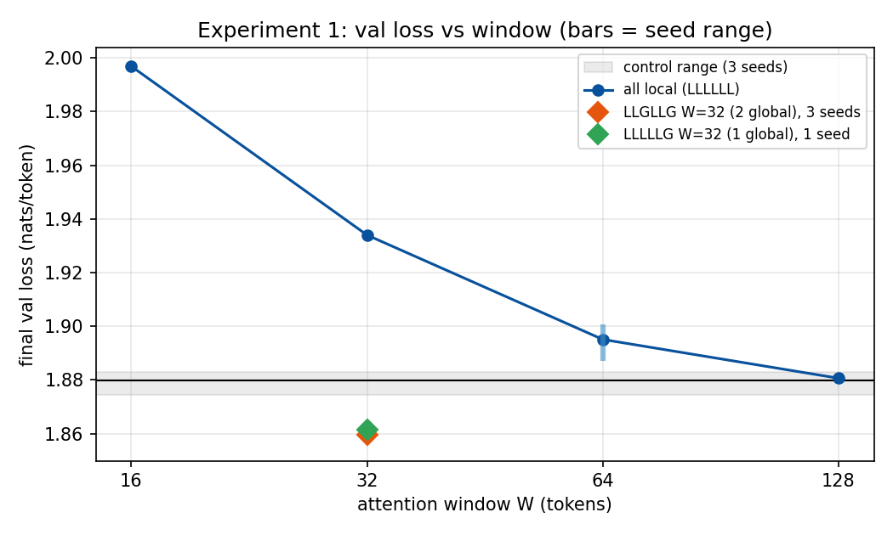
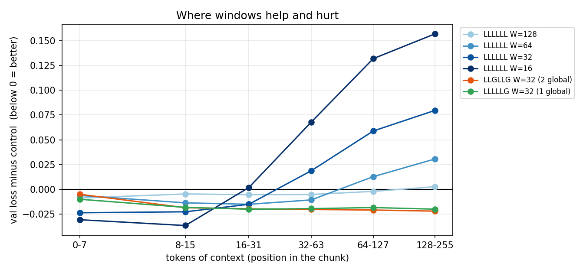
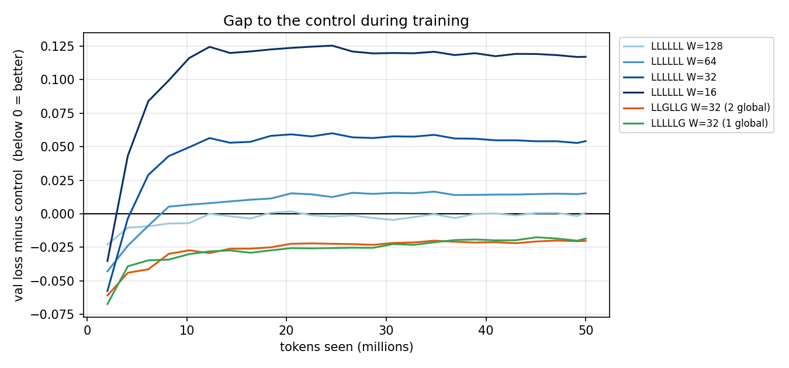

# Results log

Running notes, written as each step finishes (ground rule 8). The blog post is
written from this file. All numbers come from `runs/*/summary.json` and
`results/*.csv`; every run folder records its config, git commit and data hashes.

---

## Setup (shared by every experiment)

**Data.** TinyStories (`roneneldan/TinyStories`). Byte-level BPE tokenizer,
vocab 4,096, trained on the train split, with `</s>` appended after every story.
`train.bin` = first 100M tokens of the train split; `val.bin` = first 1M tokens
of the official validation split. SHA-256 hashes in `data/fingerprint.json`.

**Control model.** Llama-style decoder, written from scratch in PyTorch.

| Item | Value |
| --- | --- |
| Layers / width / heads | 6 / 192 / 6 (head dim 32) |
| Block | pre-RMSNorm → causal attention with RoPE → residual; pre-RMSNorm → SwiGLU (hidden 512) → residual |
| Embeddings | tied input/output, no biases |
| Init | N(0, 0.02); residual output projections scaled by 1/√(2·n_layers) |
| Params | 3,443,136 total, 2,656,704 non-embedding |
| Context | 256 tokens |

**Training.** AdamW (β = 0.9, 0.95; weight decay 0.1 on matrices only),
200-step linear warmup then cosine decay to 10% of peak, grad clip 1.0,
batch 32 × 256 = 8,192 tokens/step, 50M tokens (6,103 steps) per headline run.
Random training windows; batch order depends only on the seed.

**Evaluation.** Mean cross-entropy (nats/token) on a fixed slice of
491,520 validation tokens (60 batches of 32 × 256 non-overlapping windows),
identical for every run.

**Hardware.** MacBook Pro M4, PyTorch MPS backend, fp32.

**Tests.** 56 tests in total. The 29 from Step 1: RoPE (norm preservation, relative-position property),
RMSNorm vs reference, causality, KV-cached decoding = full forward
(MHA, GQA, MQA, custom head_dim), GQA = MHA with shared K/V weights,
overfitting one batch, exact parameter count, initial loss ≈ ln(4096).

---

## Step 1: control model

### LR sweep

Peak LR swept at **10M tokens, seed 1337** (each run is a complete short
schedule: warmup + cosine over 1,220 steps).

| Peak LR | Final val loss |
| --- | --- |
| 1e-3 | 2.4282 |
| 2e-3 | 2.3034 |
| 3e-3 | 2.2669 |
| **6e-3** | **2.2456** (best measured) |
| 1.2e-2 | 2.3832 |

- The curve is U-shaped on a log-LR axis, and **asymmetric**: halving the LR
  from 6e-3 costs +0.021, doubling it costs +0.138. Too high hurts far more
  than too low.
- A parabola through 3e-3 / 6e-3 / 1.2e-2 (log axis) puts the minimum near
  **4.7e-3**, about 0.01 below 6e-3 (noise level).
- **Chosen: 5e-3**, rounding toward the fitted minimum and toward the lower
  side, because (a) the U is asymmetric and (b) the headline runs are 5×
  longer, and longer runs tend to prefer a slightly lower LR.
- The LR choice moved the loss by up to 0.18 at 10M tokens, ~20× the seed
  noise below. An untuned baseline (the original 3e-4) would have been well
  below the swept range.
- Experiments 1 and 2 reuse this LR: their changes (attention windows, sinks)
  don't change the weight shapes. Experiment 3's S and L sizes get their own
  short sweeps.

### Control: 3 seeds at 50M tokens, LR 5e-3

| Seed | Final val loss | Train tokens/s | Wall-clock |
| --- | --- | --- | --- |
| 1337 | 1.8830 | 33,140 | 27.4 min |
| 1338 | 1.8743 | 33,677 | 26.9 min |
| 1339 | 1.8821 | 33,508 | 27.1 min |
| **Mean** | **1.8798** (min 1.8743, max 1.8830) | | |

**Seed spread (max − min) = 0.0087.** This is the noise floor for every later
comparison: a difference under ~0.01 is not distinguishable from seed noise;
0.02 or more is a real effect (when it holds across seeds).

Perplexity e^1.88 ≈ 6.6: on average the model is as unsure as a uniform
choice among ~6.6 tokens (vs 4,096 at initialisation).

### Costs (ground rule 3)

| | Value |
| --- | --- |
| Params | 3,443,136 (2,656,704 non-embedding) |
| Train throughput | 33.1k–33.7k tokens/s |
| Wall-clock per 50M-token run | ~27 min |
| Peak GPU memory (MPS driver) | ~2.3 GB |
| KV cache, fp32 | 2.25 MB at T = 256 · 36 MB at T = 4,096 |

KV cache = 2 (K and V) × 6 layers × T × 6 KV heads × 32 dims × 4 bytes.
Every layer is global, so it grows linearly with T. This is the number
Experiment 1 tries to shrink.

### Observations

- **Still improving at 50M tokens.** Val loss fell ~0.02 over the last ~600
  steps (seed 1337: 1.9035 at step 5,500 → 1.8830 at 6,103). The model is
  undertrained; comparisons stay fair because every variant gets the same
  50M-token budget.
- **More data matters a lot here.** At LR 6e-3: 10M tokens → 2.246; at 5e-3:
  50M tokens → ~1.88.
- **Train loss ends ~0.025 below val, without overfitting.** Each run sees
  50M of the 100M training tokens, so nearly every training window is new
  text and the train loss is effectively held-out loss on the train split.
  The gap reflects the validation split being slightly harder.
- **Samples are coherent short stories** with consistent characters and simple
  plots (see `runs/control_seed*/sample.txt`). All three seeds open with the
  same sentence because samples use a fixed sampling seed; they diverge after
  a few lines.

Sample (seed 1338, temperature 0.8, top-k 50):

> Once upon a time, there was a little boy named Tim. Tim loved to play with
> his toy cars. One day, he found a big tree. The tree was very tall and had
> many branches that he wanted to touch. Tim thought the tree looked fun and
> he wanted to touch it. [...]

### Caveats

- One dataset (TinyStories), one model size, fp32 on one machine.
- The LR was tuned at 10M tokens and used at 50M.
- Three seeds give a rough noise estimate, not a confidence interval.

---

## Step 2: Gemma 3 270M parity

**Goal:** prove the implementation is correct by loading Google's real
Gemma 3 270M weights into *this* codebase and matching Hugging Face
`transformers` output. Inference only, fp32, CPU.

### How Gemma differs from the control

Gemma 3 is the same decoder with every difference added as a config flag
(defaults = the control, guarded by an exact parameter-count test and a
regression test that re-evaluates the trained control checkpoint).
Diagram: [`figures/gemma3_architecture.svg`](figures/gemma3_architecture.svg).

| Difference | Control | Gemma 3 270M | Flag |
| --- | --- | --- | --- |
| RMSNorm scale | `x̂ · w` (w = 1 at init) | `x̂ · (1 + w)` (w = 0 at init) | `norm_offset` |
| Embedding scale | none | × √640 | `embed_scale` |
| QK-norm | none | RMSNorm on each q/k head, before RoPE | `qk_norm` |
| Norms per block | 2 (pre-norm) | 4 (pre + post "sandwich") | `post_norm` |
| MLP | SwiGLU | GeGLU (GELU, tanh approximation) | `mlp_activation` |
| Attention heads | 6 Q / 6 KV, head_dim 32 = d/heads | 4 Q / 1 KV (MQA), head_dim 256 ≠ 640/4 | `n_kv_heads`, `head_dim` |
| Layer pattern | all global | 5 local : 1 global (18 layers) | `layer_pattern` |
| Sliding window | — | 512 tokens | `window` |
| RoPE base | 10,000 | 10,000 local · 1,000,000 global | `rope_base`, `rope_base_local` |

Attention works in 4 × 256 = 1,024 dimensions while the residual stream is
640 wide: `Wq` maps 640 → 1,024 and `Wo` maps back.

63% of "270M" is the embedding table (262,144 × 640 = 167.8M); the 18
transformer layers hold ~100M parameters.

### Method

1. **Read the reference first.** Every difference was taken from the
   installed `transformers` source (`modeling_gemma3.py`, `masking_utils.py`)
   and the checkpoint's `config.json`, not from memory.
2. **Shape check.** Building the model in Gemma's shape gives exactly
   268,098,176 parameters, Google's published count.
3. **Each feature vs Hugging Face's own module**, on random weights
   (RMSNorm, scaled embedding, MLP), plus property tests (QK-norm makes
   attention invariant to the scale of Wq/Wk; window mask sees exactly the
   last W tokens; receptive field grows by W−1 per local layer).
4. **Whole-model parity on a tiny random Gemma** built by `transformers`
   (6 layers, window 8, attention wider than d_model, every weight including
   norms randomised, unusual RoPE bases), logits and greedy decoding.
5. **Real weights.** Converter = renaming only (both sides use
   `nn.Linear` [out, in]; no transposes). All 236 tensors must be used and
   every parameter filled (strict loading both ways). bf16 → fp32.

### Result

| Prompt | Tokens | Max \|logit diff\| | Top-1 agreement | Greedy, 30 tokens |
| --- | --- | --- | --- | --- |
| The capital of France is | 6 | 4.10e-05 | 100% | identical |
| Once upon a time, a little dragon | 9 | 4.96e-05 | 100% | identical |
| def fibonacci(n): | 7 | 6.91e-05 | 100% | identical |
| Water boils at a temperature of | 7 | 6.39e-05 | 100% | identical |
| The three primary colors are | 6 | 5.82e-05 | 100% | identical |
| Model card, first 800 tokens | 800 | 1.81e-04 | 100% | — |

Source: `results/gemma_parity.csv` (`scripts/gemma_parity.py`).

- **Logits agree to ~1e-4** (target was ~1e-3) across all 262,144 vocabulary
  entries at every position. The remaining difference is fp32 rounding from
  operations done in a different order over 18 layers.
- **The 800-token prompt is the sliding-window test.** The five short
  prompts never exceed the 512-token window, so local layers never cut
  anything; the long one does, and still agrees on the top-1 token at all
  800 positions. Its slightly larger difference (1.8e-4) is rounding
  accumulating over more positions.
- **Greedy generation is identical** (our KV-cached decoding vs Hugging
  Face), and the text is sensible: "The capital of France is Paris…",
  a correct `fibonacci` function, water boils at 100 °C.
- The generations repeat themselves ("It is the most visited city in the
  world. It is the most visited city…"). That is expected from a small
  *base* (not instruction-tuned) model under greedy decoding, not a bug:
  it matches Hugging Face token for token.

### Pitfalls (the traps this checks for)

Parity matched on the first run on real weights, because every feature had
already been matched against Hugging Face's modules on random weights. The
traps that approach caught or avoided:

- **`(1 + w)` norms.** Gemma stores norm weights near 0. Read with the Llama
  convention they would scale every activation by ~0, silently.
- **The `post_attention_layernorm` name.** In HF Llama it is the norm
  *before* the MLP; in Gemma 3 it is the norm on the attention *output*.
  Same string, different job; mapped by function, not by name.
- **`head_dim` ≠ d_model / heads.** Projections must be sized by
  heads × head_dim (1,024), or the weights don't even load.
- **GELU variant.** Gemma uses the tanh approximation; exact GELU differs by
  up to ~1e-3, enough to break parity.
- **No `lm_head` in the checkpoint.** The output layer is tied to the
  embedding; Google stores the 168M-parameter matrix once.
- **bf16 checkpoint.** Compared in fp32; bf16's ~3 significant digits would
  hide real bugs.
- **Short prompts don't test the window.** Needed an input longer than 512
  tokens.
- **Random-weight tests must randomise norms too.** A zero-initialised Gemma
  norm makes `w` and `1 + w` look identical for a Llama norm at init.

### Not covered

- The local layers' KV cache still stores every token (correct, via the
  mask, but no memory saved yet); a rolling cache comes in Experiments 1-2.
- Checked on CPU in fp32 only, and only for the 270M model.

## Experiment 1: local/global attention

**Question:** how small can attention windows get before loss suffers, and
how much KV-cache memory does that save?

**Setup.** The control (all 6 layers global) with one change per variant:
a layer pattern (`L` = local/sliding-window, `G` = global) and a window size
W. Everything else identical: data, LR 5e-3 (tuned for the control), 50M
tokens, fixed val slice. Seed 1337 first; extra seeds only where the gap fell
between 0.01 and 0.03 (the control's seed spread is 0.0087).

### Result

| Variant | Global layers | Seeds | Val loss | vs control | KV @ 256 | KV @ 4,096 |
| --- | --- | --- | --- | --- | --- | --- |
| `GGGGGG` (control) | 6 | 3 | 1.8798 (1.8743–1.8830) | — | 2.25 MB | 36.0 MB |
| `LLLLLL` W=128 | 0 | 1 | 1.8806 | +0.001 | 1.13 MB | 1.13 MB |
| `LLLLLL` W=64 | 0 | 3 | 1.8951 (1.8870–1.9008) | **+0.015** | 0.56 MB | 0.56 MB |
| `LLLLLL` W=32 | 0 | 1 | 1.9340 | **+0.054** | 0.28 MB | 0.28 MB |
| `LLLLLL` W=16 | 0 | 1 | 1.9969 | **+0.117** | 0.14 MB | 0.14 MB |
| `LLGLLG` W=32 | 2 | 3 | **1.8596** (1.8569–1.8629) | **−0.020** | 0.94 MB | 12.2 MB |
| `LLLLLG` W=32 | 1 | 1 | **1.8613** | **−0.019** | 0.61 MB | **6.2 MB** |

KV = fp32 cache for one sequence; measured from the rolling cache during
generation and equal to the formula to the byte
(`results/exp1_generation.csv`).

### Findings

1. **All-local: loss rises steadily as the window shrinks.** W=128 matches
   the control; W=64 is slightly but consistently worse (all 3 seeds above
   all 3 control seeds); W=32 and W=16 are clearly worse.
2. **Hybrids beat full attention.** `LLGLLG` W=32: all 3 seeds better than
   all 3 control seeds (the worst hybrid beats the best control by 0.011);
   −0.020 nats with 3× less KV memory at 4,096 tokens. Since the LR was tuned
   for the control and reused, the setup favours the control, not the hybrid.
3. **One global layer is enough (single seed).** `LLLLLG` (Gemma 3's 5:1
   ratio) lands within 0.002 of `LLGLLG` at half its long-context memory
   (5.8× less than the control). Adding the 1st global layer to an all-local
   W=32 model moves the loss by 0.073; the 2nd adds ~0.002.
4. **Once a model has a global layer, the window barely matters for memory.**
   At 4,096 tokens the global layer's cache dominates: `LLLLLG` at W=16 would
   need 6.1 MB vs 6.2 MB at W=32. The number of global layers sets the cost;
   this is why Gemma can afford a 512-token window.

### Mechanism: where windows help and hurt

Loss difference to the control by tokens of context (mean over seeds;
`results/exp1_by_position.csv`):

| Variant | 0–7 | 8–15 | 16–31 | 32–63 | 64–127 | 128–255 |
| --- | --- | --- | --- | --- | --- | --- |
| W=16 | −0.031 | −0.037 | +0.002 | +0.068 | +0.132 | +0.157 |
| W=32 | −0.024 | −0.023 | −0.015 | +0.019 | +0.059 | +0.080 |
| W=64 | −0.006 | −0.014 | −0.015 | −0.011 | +0.013 | +0.031 |
| W=128 | −0.009 | −0.005 | −0.005 | −0.005 | −0.002 | +0.003 |
| `LLGLLG` W=32 | −0.005 | −0.019 | −0.020 | −0.021 | −0.021 | −0.022 |
| `LLLLLG` W=32 | −0.010 | −0.018 | −0.020 | −0.020 | −0.019 | −0.020 |

- **Local attention has two opposite effects.** Every all-local model is
  *better* than the control with little context and *worse* with a lot.
  Restricting attention to nearby tokens appears to make short-range patterns
  easier to learn; it costs whatever lies out of reach.
- **The penalty starts after ~2W, not W.** Six stacked local layers relay
  information backwards (receptive field 6·(W−1)), but relaying is lossy, so
  the penalty grows with distance.
- **The hybrids keep the short-range advantage at every distance:** the
  global layer(s) cover what the local layers can't reach.
- Context itself: the control's loss falls from 4.0 with no context to ~1.81
  with 128+ tokens, but almost all of that gain comes from the first ~64
  tokens. TinyStories is fairly local.

### Is the hybrid advantage just faster learning?

The hybrids' lead is largest early (−0.06 at 2M tokens), shrinks over the
first ~20M tokens, then holds steady at −0.020 to −0.021 for the last 30M.
All-local models start ahead too, then fall behind once the control learns
to use long-range context (from ~4M tokens on). So part of the advantage is
faster learning, but at this budget a stable gap remains. Whether it survives
much longer training is untested.

### Generation benchmark

Measured KV memory equals the formula exactly for every variant.

Tokens/sec while generating (greedy, rolling cache, M4 GPU), benchmarked in
reverse order (control last) to rule out GPU warm-up effects:

| Variant | 256 tokens | 4,096 tokens |
| --- | --- | --- |
| `GGGGGG` (control) | 301 | 310 |
| `LLGLLG` W=32 | 302 | 291 |
| `LLLLLL` W=64 | 528 | 700 |
| `LLLLLL` W=16 | 623 | 719 |

- **All-local models generate ~2.3× faster; any global layer brings the
  speed back down to the control's.** The order didn't matter (same result
  with the control first or last).
- **The speed does not depend on context length** (the control is as fast at
  4,096 tokens as at 256), so the cost is not the attention arithmetic.
- **Likely cause (hypothesis, untested):** a global layer's cache grows by one
  entry every step, so its tensors have a new shape each step. Apple's GPU
  backend prepares (and caches) work per tensor shape, so a new shape every
  step defeats that caching. A rolling local cache stops changing shape once
  it holds W entries. Production systems avoid this with a *pre-allocated*
  ("static") KV cache of fixed size. Testing that is out of scope here.
- So at this scale, speed differences come from the implementation, not from
  attention cost. The architectural benefit measured here is memory.

### Predictions vs outcome

| Prediction (made before running) | Outcome |
| --- | --- |
| W=64 and W=128 ≈ control | W=128 ✓; W=64 slightly worse (+0.015) |
| W=16 and W=32 clearly worse | ✓ |
| `LLGLLG` W=32 recovers most of the gap | Exceeded: beats the control |
| Risk: TinyStories too local to show anything | Did not happen |

### Caveats

- One dataset (TinyStories), 256-token context, 3.4M parameters, 50M tokens.
  "Hybrid beats full attention" holds in this setting, not in general.
- W=16, W=32, W=128 and `LLLLLG` are single-seed. Their gaps (except
  `LLLLLG`) are far outside the noise floor; `LLLLLG`'s matches `LLGLLG`'s
  but is not confirmed by extra seeds.
- Training speed is not reported: masked attention computes the full matrix,
  so windows don't make training faster here, and several runs were slowed
  2–3× by the machine (power/heat; later runs at the same code ran at normal
  speed).
- Exp 1 runs were started with uncommitted changes (`-dirty` in
  `git_commit.txt`): the sweep mode and the rolling cache. Neither changes
  training (without a cache the attention computation is identical), and the
  regression test confirms the control still gives its recorded loss.
